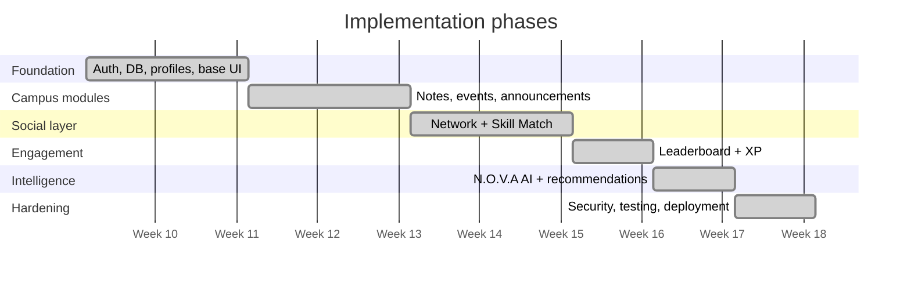

<div align="center">

<picture>
  <source media="(prefers-color-scheme: light)" srcset="assets/hero-light.svg">
  
</picture>

<br/>

**An inter-college student network for notes, events, opportunities, teammates and AI-powered answers, all in one place.**

<br/>

[](https://campus-connect-beta-weld.vercel.app/)


<br/>

[Problem](#-the-problem) · [Features](#-features) · [Screenshots](#-product-tour) · [Architecture](#-architecture) · [N.O.V.A](#-nova--the-campus-ai) · [Skill Match](#-skill-match-engine) · [Attendance](#-attendance-guardian) · [Tech Stack](#-tech-stack) · [Roadmap](#-roadmap)

</div>

<br/>

<picture>
  <source media="(prefers-color-scheme: light)" srcset="assets/stats-light.svg">
  
</picture>

<p align="center">
<picture>
  <source media="(prefers-color-scheme: light)" srcset="assets/divider-light.svg">
  
</picture>
</p>

## ⚡ The Problem

Student life runs on scattered channels: notes buried in one WhatsApp group, an event poster in another, an internship in a Telegram channel, and the right teammate found only through luck.

<table>
<tr>
<td width="50%" valign="top">

### 🔴 Before: fragmented silos

- *"Bro who has OS Unit 3 handwritten notes?"* lost among 400 unread messages across 6 groups
- *"Need 1 Flutter developer for hackathon tomorrow!"* a physical notice-board poster, zero responses from other colleges
- *"Am I going to be detained in DBMS?"* guesswork instead of math
- Opportunities missed because nobody forwarded them

</td>
<td width="50%" valign="top">

### 🟢 After: Campus Connect

- **Verified study repository**, searchable by semester and subject, with AI-generated summaries
- **Teammate match engine** using semantic embeddings across skills, branch and hackathon roles
- **Attendance Guardian** that calculates exactly how many classes you can safely skip
- **One feed** for events, announcements and opportunities

</td>
</tr>
</table>

<p align="center">
<picture>
  <source media="(prefers-color-scheme: light)" srcset="assets/divider-light.svg">
  
</picture>
</p>

## 🧩 Features

| # | Module | What it does |
|:-:|---|---|
| 01 | **Student Dashboard** | Bento-style command hub with daily streak, XP levels, campus rank and priority feeds |
| 02 | **Study Materials** | Semester-sorted notes, cheatsheets and solved past papers with Gemini summaries |
| 03 | **Events & Tickets** | Hackathons, tech talks and competitions with QR tickets and verifiable certificates |
| 04 | **Announcements** | Structured notices with publisher, category and audience, not lost chat history |
| 05 | **Opportunities** | Internships, research fellowships and hackathons with match percentage and a Kanban application tracker |
| 06 | **Network** | Peer and mentor directory across 15 colleges, with a hackathon collab board and realtime chat |
| 07 | **Skill Match** | Describe your idea in plain English; Gemini extracts skills and ranks complementary teammates |
| 08 | **Leaderboard** | Verified proof-of-contribution ranking across campuses (weekly, monthly, all-time) |
| 09 | **N.O.V.A Assistant** | RAG assistant grounded in live campus data, never invented answers |
| 10 | **Attendance Guardian** | Per-subject forecasting with safe-bunk math and a CSV audit export |
| 11 | **Admin / Moderation** | Role-based publishing and content approval |

<p align="center">
<picture>
  <source media="(prefers-color-scheme: light)" srcset="assets/divider-light.svg">
  
</picture>
</p>

## 🖼️ Product Tour

> All screenshots are from the [live deployment](https://campus-connect-beta-weld.vercel.app/).

### Landing

<p align="center">
  
</p>

<table>
<tr>
<td width="50%"></td>
<td width="50%"></td>
</tr>
<tr>
<td width="50%"></td>
<td width="50%"></td>
</tr>
</table>

### Try the matchmaking, sign up, and get started

<table>
<tr>
<td width="50%"></td>
<td width="50%"></td>
</tr>
</table>

### Inside the app

<details open>
<summary><b>📊 Dashboard</b>: streaks, XP, rank, attendance health, N.O.V.A</summary>
<br/>

</details>

<details>
<summary><b>📚 Study Materials</b>: 840+ verified academic documents</summary>
<br/>

</details>

<details>
<summary><b>🎟️ Events</b>: hackathons, talks and competitions with QR tickets</summary>
<br/>

</details>

<details>
<summary><b>💼 Opportunities</b>: internships, research and hackathons with skill-match scores</summary>
<br/>

</details>

<details>
<summary><b>🌐 Network</b>: peers and mentors across 15 colleges</summary>
<br/>

</details>

<details>
<summary><b>🏆 Leaderboard</b>: inter-college merit matrix</summary>
<br/>

</details>

<details>
<summary><b>🤖 N.O.V.A Assistant</b>: grounded campus intelligence</summary>
<br/>

</details>

<details>
<summary><b>🛡️ Attendance Guardian</b>: safe-bunk simulator</summary>
<br/>

</details>

<details>
<summary><b>🧭 Skill Match & Squad Builder</b>: natural language to ranked teammates</summary>
<br/>

</details>

<p align="center">
<picture>
  <source media="(prefers-color-scheme: light)" srcset="assets/divider-light.svg">
  
</picture>
</p>

## 🏗️ Architecture

<picture>
  <source media="(prefers-color-scheme: light)" srcset="assets/architecture-light.svg">
  
</picture>

### Roles

| Role | Can do |
|---|---|
| **Student** | Browse, search, maintain profile, register for events, connect, contribute materials |
| **Organizer / Club** | Create and manage their own events and opportunities |
| **Department / Admin** | Publish official announcements, moderate and approve content |

<p align="center">
<picture>
  <source media="(prefers-color-scheme: light)" srcset="assets/divider-light.svg">
  
</picture>
</p>

## 🤖 N.O.V.A: the Campus AI

**N**avigation & **O**pportunity **V**oice **A**ssistant answers from your platform data rather than guessing.

<picture>
  <source media="(prefers-color-scheme: light)" srcset="assets/nova-light.svg">
  
</picture>

Example questions: *"Am I short on attendance for any subjects this semester?"*, *"What hackathons and tech symposiums are happening this month?"*, *"Who knows Flutter at BMSCE?"*

<p align="center">
<picture>
  <source media="(prefers-color-scheme: light)" srcset="assets/divider-light.svg">
  
</picture>
</p>

## 🧭 Skill Match Engine

Two layers work together:

1. **Layer 1, rules:** overlap of required skills versus profile skills.
2. **Layer 2, semantics:** 768-dimension Gemini embeddings compared by cosine similarity in pgvector.

```text
Rule score = matched required skills ÷ total required skills × 100
```

<picture>
  <source media="(prefers-color-scheme: light)" srcset="assets/skillmatch-light.svg">
  
</picture>

<p align="center">
<picture>
  <source media="(prefers-color-scheme: light)" srcset="assets/divider-light.svg">
  
</picture>
</p>

## 🛡️ Attendance Guardian

Hall-ticket eligibility is a math problem, so Campus Connect treats it like one.

<picture>
  <source media="(prefers-color-scheme: light)" srcset="assets/attendance-light.svg">
  
</picture>

```text
Attendance %         = attended ÷ total × 100
Classes you can skip = floor(attended ÷ 0.75 − total)
Classes you must attend (if short) = ceil(3 × total − 4 × attended)
```

The 75% threshold is configurable per institution. Records are **owner-only** and protected by RLS.

<p align="center">
<picture>
  <source media="(prefers-color-scheme: light)" srcset="assets/divider-light.svg">
  
</picture>
</p>

## 🛠️ Tech Stack

<div align="center">


</div>

| Layer | Technology |
|---|---|
| Frontend | React.js |
| Backend | Node.js + Express.js (REST APIs) |
| Database | PostgreSQL with Row Level Security and `pgvector` |
| AI | Google Gemini (skill parsing, embeddings, summaries, RAG) |
| Deployment | Vercel |

<p align="center">
<picture>
  <source media="(prefers-color-scheme: light)" srcset="assets/divider-light.svg">
  
</picture>
</p>

## 🔐 Security & Privacy

- Passwords are hashed, never stored in plaintext
- Verified college-domain authentication
- Strict **Row Level Security** on every table
- Role-based authorization for publishers and admins
- Input validation and sanitization
- Protected file uploads
- Secrets kept in environment variables
- Audit logging for administrative actions

<p align="center">
<picture>
  <source media="(prefers-color-scheme: light)" srcset="assets/divider-light.svg">
  
</picture>
</p>

## 🗺️ Roadmap



**Next up:** mobile apps · push notifications for deadlines · personalized AI feed · multi-skill team optimization · alumni mentorship · club analytics dashboard.

<p align="center">
<picture>
  <source media="(prefers-color-scheme: light)" srcset="assets/divider-light.svg">
  
</picture>
</p>

## 🚀 Run Locally

```bash
git clone https://github.com/<your-username>/campus-connect.git
cd campus-connect

npm install
cp .env.example .env     # add your database URL and Gemini API key
npm run dev
```

> Update the clone URL and scripts to match your repository.

<p align="center">
<picture>
  <source media="(prefers-color-scheme: light)" srcset="assets/divider-light.svg">
  
</picture>
</p>

## 🏆 About

Built during a **9-week full-stack internship** under the **Rotaract Club of Atria I.T. × Department of CSE (Mar–Jun 2025)** and ranked **Top 4 out of 60+ projects**.

<div align="center">

<br/>

**[→ Open the live app](https://campus-connect-beta-weld.vercel.app/)**

<sub>Campus Connect · one unified grid across all campuses</sub>

</div>
